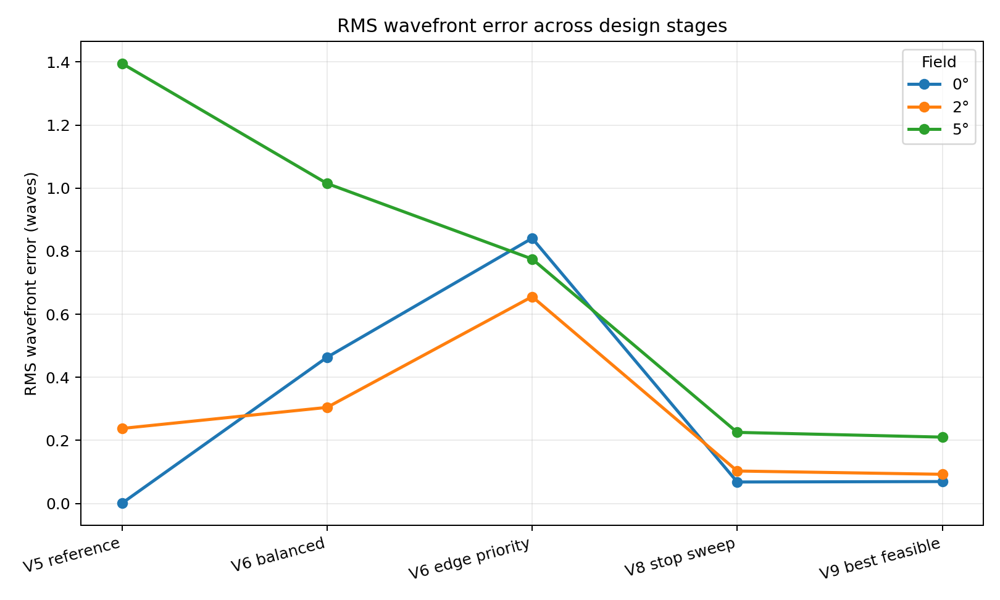
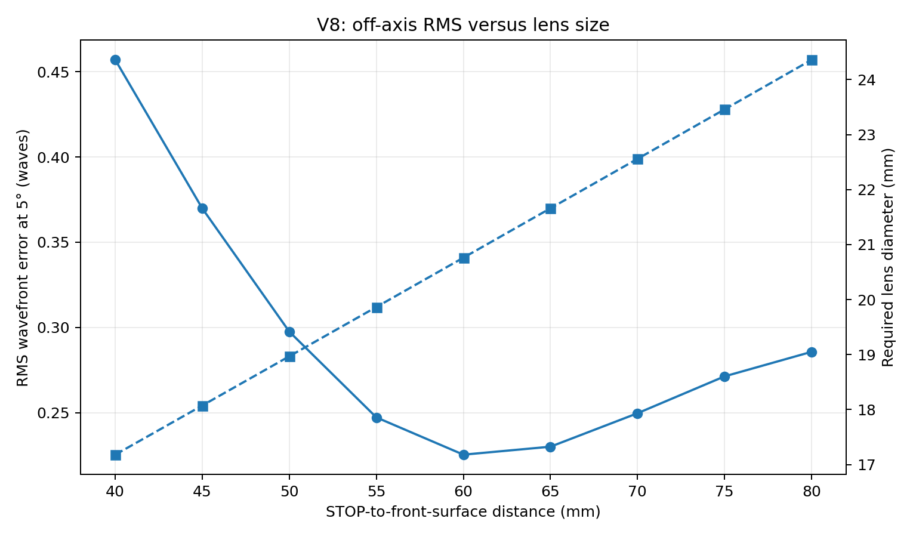
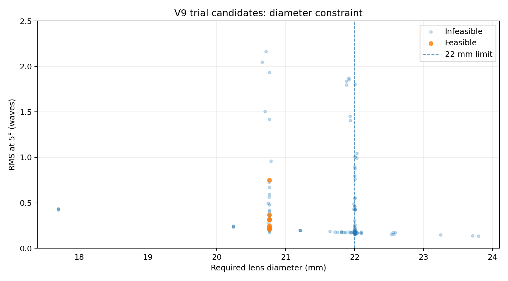

# Computational Optical Design — Zemax OpticStudio + Python

**Numerical optimization of a multi-field N-BK7 singlet using the Zemax ZOS-API.**

This portfolio demonstrates reproducible optical-model construction, parameter sweeps, constrained optimization, and independent inspection of optical performance in OpticStudio. The selected deliverable is the **best feasible V9 candidate**, not a claim of globally optimal design.

## Design specification

| Property | Value |
|---|---|
| Optical system | Singlet; front even-asphere, rear spherical |
| Material | N-BK7 |
| Design wavelength | 550 nm |
| Field angles | 0°, 2°, 5° |
| Target effective focal length | 50 mm |
| Entrance pupil diameter | 10 mm |
| Maximum required lens diameter (V9) | 22 mm |
| Optimization | Python/SciPy + OpticStudio ZOS-API |

## Key performance results

RMS wavefront error in **waves** at the design wavelength:

| Design | 0° | 2° | 5° |
|---|---:|---:|---:|
| V5 on-axis optimized | 0.000689 | 0.237875 | 1.395259 |
| V6 balanced | 0.463605 | 0.304644 | 1.014648 |
| V6 edge priority | 0.841015 | 0.655820 | 0.775231 |
| V8 best STOP sweep (60 mm) | 0.068062 | 0.102907 | 0.225401 |
| **V9 best feasible** | **0.069422** | **0.092456** | **0.210348** |

Relative to V5, V9 reduces the **5° RMS error by approximately 84.9%**, while sacrificing the near-perfect on-axis result. Relative to V8, V9 improves 2° and 5° RMS. This is a multi-field trade-off, not a universal improvement at every field.

**Selected V9 candidate:** STOP position 60 mm; required lens diameter ~20.762 mm (within the 22 mm limit); EFL independently checked in OpticStudio at ~49.99996 mm. The V9 optimizer reached its evaluation limit, so **numerical convergence was not established**. The selected result satisfies the implemented feasibility checks.

## Results and figures







- `results/v9_joint/V9_best_feasible.zos`: **recommended model to open first** in OpticStudio.
- `results/v9_joint/v9_trials.csv`: optimization history and feasibility flags.
- `results/v8_stop_sweep_40_80/stop_sweep.csv`: STOP-position sweep.
- `results/v6/comparison.csv`: earlier multi-field comparisons.
- `results/summary/design_summary.csv`: condensed cross-stage table.
- `results/v5`–`results/v9_joint`: selected model snapshots and numerical outputs.

## Running the scripts

From the repository root, use the relevant script. Review the command-line options and local OpticStudio configuration before execution.

```powershell
python src/optimize_asphere_v5.py --help
python src/optimize_multifield_v7.py --help
python src/stop_position_sweep_v8.py --help
python src/optimize_multifield_v9.py --help
```

The `field1.CFG`, `field2.CFG`, and `field3.CFG` files are retained for the three-field Zernike analysis. They are OpticStudio configuration files, not Python dependencies. Some scripts use local defaults or generate their own output folders; inspect their options before running. **Do not assume the optimization will reproduce identical candidates on every machine.**

## Validation and limitations

- Prescription Data in OpticStudio confirmed EFL approximately 50 mm for the selected V9 design.
- The front/rear footprint checks showed **100% rays through for the sampled rays** (Ray Density 20), not a guarantee of zero vignetting under every condition.
- FFT MTF was inspected visually at 550 nm (256×256 sampling, maximum plotted frequency 370 cycles/mm), but numeric MTF curves were not exported, so no numerical MTF improvement is claimed.
- The 5° field is **not diffraction limited**.
- Manufacturing tolerances, thermal performance, stray light, edge thickness under tolerances, and fabrication feasibility are not comprehensively validated.
- Historical optimizer reports with thousands of repetitive iteration dumps and generated `.ZDA` sidecars are omitted from this GitHub-friendly release. Original CSV logs and `.zos` designs are retained.

## Project organization

```text
src/                     ZOS-API scripts (model construction, V5–V9 optimization)
results/                 Original CSV outputs and selected .zos models
results/summary/         Cross-stage design summary
figures/                 Portfolio plots
field1.CFG ... field3.CFG  Zernike analysis settings
requirements.txt         Python dependencies
```
